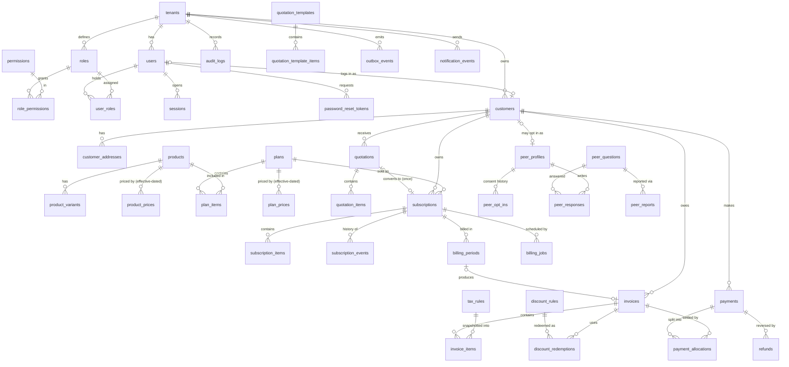
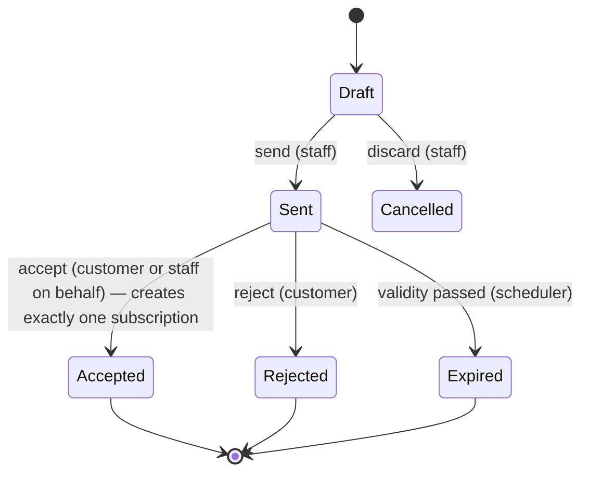
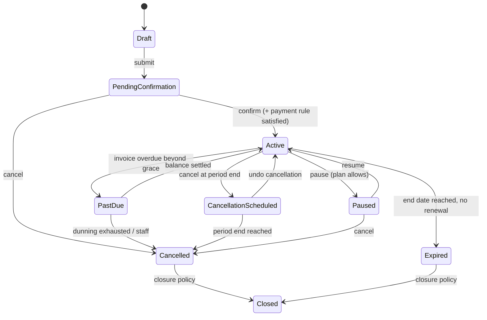
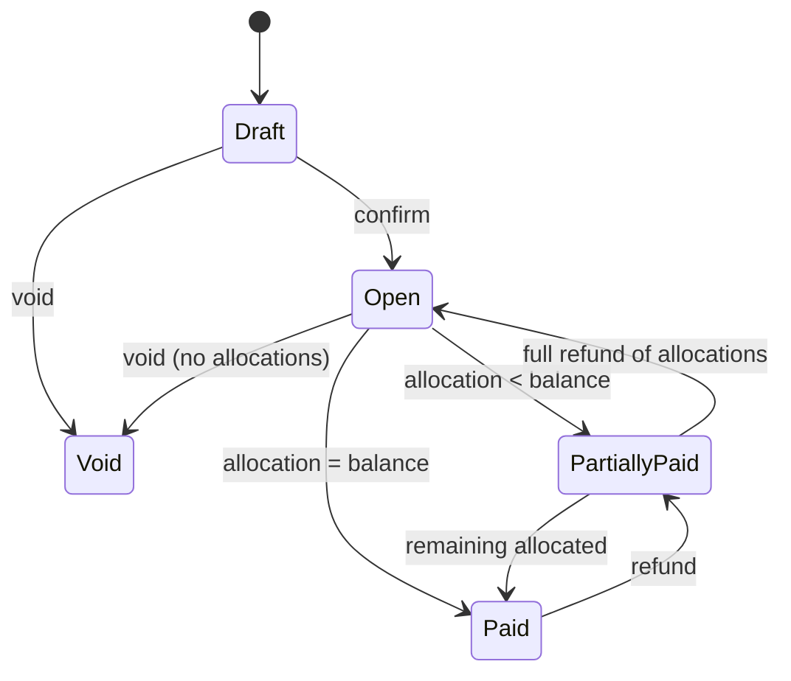
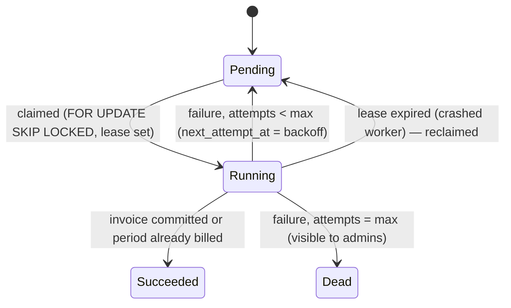

# Brightloop Subscription OS — System Architecture

Status: Phase 0 baseline (2026-10-31). Update this file whenever the architecture changes.

## 1. Shape of the system

A **modular monolith**: one FastAPI backend divided into domain modules, one Vite + React
single-page frontend, one PostgreSQL database. Background work (billing scheduler, worker,
outbox dispatcher) runs as separate Python processes built from the same backend package.

```text
Browser (Vite + React SPA, TypeScript)
  ├── Public catalogue / auth pages
  ├── Admin console   (/admin)
  ├── Staff workspace (/staff)
  ├── Customer portal (/portal)
  └── Optional browser ML runtime (Web Worker, ONNX Runtime Web) — Phase 7
          │  same-origin /api/v1  (Vite dev proxy locally, nginx proxy in Docker)
          ▼
FastAPI application (backend/app)
  ├── auth · tenants · users · customers · audit            (Phase 1)
  ├── catalog · quotations · subscriptions                  (Phase 2)
  ├── billing · invoicing · taxes · discounts               (Phase 3)
  ├── payments · notifications                              (Phase 4)
  ├── analytics                                              (Phase 5)
  ├── peers                                                  (Phase 6)
  └── ai (filter schema, model metadata)                     (Phase 7)
          │
          ├── PostgreSQL 16 — single source of truth
          ├── scheduler process (APScheduler)  → enqueues billing_jobs
          ├── worker process                   → claims jobs with FOR UPDATE SKIP LOCKED
          └── outbox dispatcher                → delivers outbox_events (email, payment sim)
```

The frontend is served **same-origin** with the API (dev: Vite proxy `/api → :8000`;
Docker: nginx proxy). This keeps session cookies first-party, avoids CORS for normal use and
lets us use `SameSite=Lax` cookies. A CORS allowlist still exists for explicit extra origins.

## 2. Backend layering

```text
app/
  api/v1/<module>.py     HTTP only: parse/validate input, call a service, shape output
  services/<module>.py   business rules, state transitions, transactions
  models/<module>.py     SQLAlchemy 2.x ORM models (the schema)
  schemas/<module>.py    Pydantic v2 request/response models
  core/                  config, db, security primitives, errors, rate limiting, deps
  workers/               scheduler, billing worker, outbox dispatcher (Phase 3+)
alembic/                 migrations (hand-reviewed; autogenerate is a starting point only)
tests/                   pytest against a real PostgreSQL test database
```

Rules:

* Route handlers never contain business rules; they call services.
* Every tenant-owned query goes through a helper that applies `tenant_id` from the
  authenticated principal — never from request input.
* Customer-scoped endpoints additionally check that the object belongs to the caller's customer.
* Every state change goes through a transition function that validates the edge and writes an
  event row. The API never accepts a raw `status` to set.

## 3. Identity, sessions and authorization

* **Passwords**: Argon2id (`argon2-cffi`), rule enforced on the backend: > 8 chars, at least one
  uppercase, one lowercase and one special character.
* **Sessions**: opaque 256-bit random token in a `Secure` (in production), `HttpOnly`,
  `SameSite=Lax` cookie `bl_session`. Only the SHA-256 hash is stored in `sessions`.
  Sessions have an absolute expiry and an idle timeout; logout and logout-all revoke rows.
  A new session id is issued on every login and on password reset (all old sessions revoked).
* **CSRF**: double-submit token. Login returns a random CSRF token in a readable cookie
  `bl_csrf`; its hash is bound to the session row. Every unsafe request (POST/PUT/PATCH/DELETE)
  that is authenticated by cookie must send `X-CSRF-Token` matching the session's token.
* **Password reset**: 256-bit random, single-use token, 30-minute expiry, only its hash is
  stored. `forgot-password` always answers 202 (no account enumeration). Mail goes to Mailpit
  locally.
* **RBAC**: `roles`, `permissions`, `role_permissions`, `user_roles`. Endpoints declare a
  permission (`require_permission("users.create_staff")`). System roles `admin`, `staff`,
  `customer` are seeded per tenant by migration/seed. Only `admin` holds `users.create_staff`;
  the staff-creation service also hard-codes that new accounts get the `staff` role only, so a
  permission mistake cannot mint admins.
* **Rate limiting**: in-process sliding window on login, register, forgot/reset password
  (and later peer questions). Single-process limitation documented in `decisions.md`.

## 4. Entity-relationship model

Conventions for every table below:

* `id uuid` primary key (`gen_random_uuid()`), `created_at`/`updated_at timestamptz` (UTC).
* Tenant-owned tables carry `tenant_id uuid NOT NULL REFERENCES tenants`.
* Money is `numeric(14,2)` plus a `currency char(3)`; rates are `numeric(7,4)` (percent).
* Sequence numbers (`SUB-000123`, `INV-2026-000045`) are unique per tenant.
* Financial rows are voided/adjusted, never deleted.



### 4.1 Tables by phase

| Phase | Tables |
|---|---|
| 1 | `tenants`, `users`, `roles`, `permissions`, `role_permissions`, `user_roles`, `sessions`, `password_reset_tokens`, `audit_logs`, `customers`, `customer_addresses` |
| 2 | `products`, `product_variants`, `product_prices`, `plans`, `plan_items`, `plan_prices`, `quotation_templates`, `quotation_template_items`, `quotations`, `quotation_items`, `subscriptions`, `subscription_items`, `subscription_events` |
| 3 | `billing_periods`, `billing_jobs`, `invoices`, `invoice_items`, `tax_rules`, `discount_rules`, `discount_redemptions`, `outbox_events` |
| 4 | `payments`, `payment_allocations`, `refunds`, `notification_events` |
| 5 | `analytics_daily_summary`, `analytics_monthly_summary`, `payment_failure_summary`, `customer_cohort_summary`, `customer_segments`, `detected_patterns` |
| 6 | `peer_profiles`, `peer_opt_ins`, `peer_questions`, `peer_responses`, `peer_reports`, `peer_blocks` |
| 7 | `model_versions` |

### 4.2 Phase 1 tables (implemented)

| Table | Key columns and constraints |
|---|---|
| `tenants` | `slug` unique, `name`, `timezone` (default `Asia/Kolkata`), `currency` (default `INR`), `is_active` |
| `users` | `tenant_id`, `email` (stored lower-case, `CHECK email = lower(email)`), `full_name`, `password_hash`, `is_active`, `last_login_at`; **unique `(tenant_id, email)`** |
| `roles` | `tenant_id`, `code` (`admin`/`staff`/`customer`), `name`, `is_system`; unique `(tenant_id, code)` |
| `permissions` | `code` unique (global catalogue, e.g. `customers.read`), `description` |
| `role_permissions` | PK `(role_id, permission_id)` |
| `user_roles` | PK `(user_id, role_id)`, `granted_by`, `granted_at` |
| `sessions` | `user_id`, `tenant_id`, `token_hash` unique, `csrf_hash`, `expires_at`, `idle_expires_at`, `revoked_at`, `ip`, `user_agent` |
| `password_reset_tokens` | `user_id`, `token_hash` unique, `expires_at`, `used_at` |
| `audit_logs` | `tenant_id`, `actor_user_id` (nullable for system), `action`, `entity_type`, `entity_id`, `data jsonb`, `ip`, `created_at`. **UPDATE/DELETE blocked by trigger.** Index `(tenant_id, created_at desc)` |
| `customers` | `tenant_id`, `user_id` (nullable, unique), `display_name`, `email`, `phone`, `company`, `industry`, `business_size`, `is_demo`; index `(tenant_id, email)` |
| `customer_addresses` | `customer_id`, `tenant_id`, `kind` (`billing`/`shipping`), `line1`, `line2`, `city`, `state`, `postal_code`, `country`, `is_default` |

Later-phase columns are specified in `product-requirements.md` and finalised in each phase's
migration; this document is updated with them as they land.

## 5. State machines

Implemented as explicit transition tables in domain services. Any edge not listed is rejected
with HTTP 409 and no state change.

### 5.1 Quotation



Acceptance locks the quotation row (`SELECT … FOR UPDATE`), checks `status = Sent`, and creates
the subscription in the same transaction. `subscriptions.quotation_id` is `UNIQUE`, so a second
acceptance can never create a second subscription even if the lock were bypassed.

### 5.2 Subscription



Every transition writes `subscription_events(actor, from, to, reason, changes jsonb)`.

### 5.3 Invoice



`overdue` is **derived** (`due_date < today AND balance > 0 AND status IN (Open, PartiallyPaid)`),
never stored as a user-settable status.

### 5.4 Billing job



### 5.5 Payment

`Pending → Succeeded | Failed`; `Succeeded → PartiallyRefunded → Refunded`. Simulator outcomes
arrive as events processed idempotently by `idempotency_key`.

### 5.6 Peer question

`Submitted → Accepted | Declined | Expired`; `Accepted → Answered`; any → `Removed` (moderator).

## 6. Recurring billing design (Phase 3, summarised)

1. Scheduler (APScheduler, every minute) inserts `billing_jobs` for subscriptions with
   `status = Active AND next_billing_at <= now()`, idempotency key
   `bill:{subscription_id}:{period_start_date}` (`ON CONFLICT DO NOTHING`).
2. Worker claims a small batch: `SELECT … WHERE status='Pending' AND next_attempt_at <= now()
   … FOR UPDATE SKIP LOCKED LIMIT n`, sets `Running` and a lease.
3. In one transaction: lock the subscription row, compute the period from the **original anchor**
   (`anchor + k × interval`, month-end clamped — never by adding 30 days), insert
   `billing_periods` (unique `(subscription_id, period_start)`), invoice and items with tax and
   discount snapshots, reserve discount redemptions, advance `next_billing_at`, insert an
   `outbox_events` row, mark the job `Succeeded`, commit.
4. A crash after commit leaves the job `Running` with an expired lease; the retry finds the
   billing period already present and succeeds without a second invoice.

## 7. Deployment topology

`docker compose up --build` at the repo root starts `postgres`, `mailpit`, `backend`
(runs `alembic upgrade head` then uvicorn) and `frontend` (static build served by nginx, which
proxies `/api`). Worker and scheduler services are added in Phase 3.
